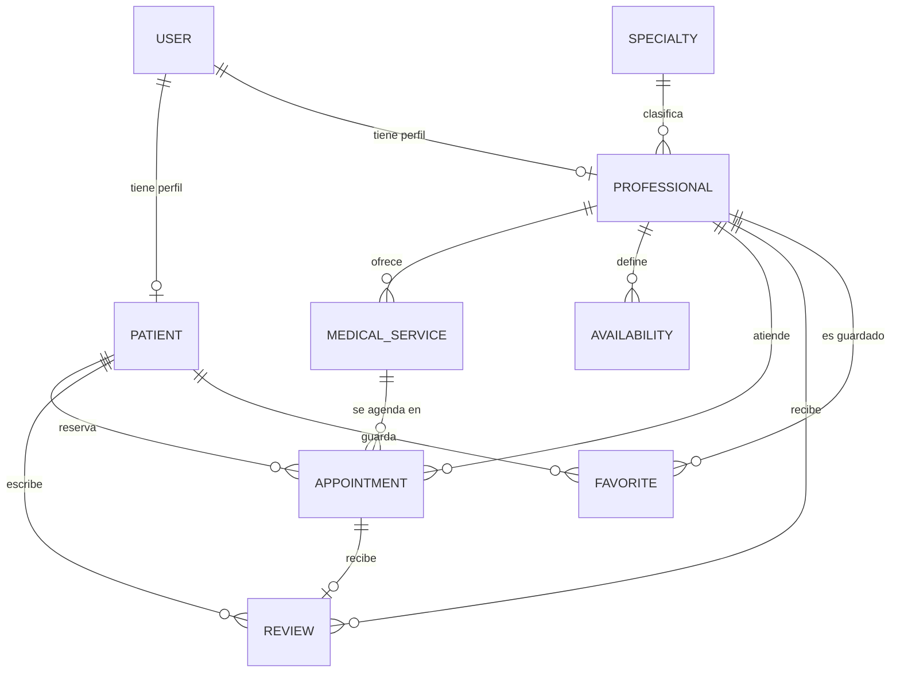

# 🩺 Salud al Toque — Backend

**API REST para buscar, comparar y reservar citas con profesionales de la salud.**

**Curso:** CS 2031 — Desarrollo Basado en Plataformas, UTEC

**Integrantes:**
- Alvaro David Pachas Chapeton
- Fabricio Alberto Olaguibel Romero
- Saul Morales Zumaeta
- Alexander Muñoz Zamora
- John Dayron Blas Huete

---

## Tecnologías

- **Java 17 · Spring Boot 3** — Web MVC, Data JPA, Security, Validation, Mail, Thymeleaf.
- **PostgreSQL 16** — Docker Compose en desarrollo local.
- **Seguridad** — JWT (JJWT 0.12, HS256, 1h de expiración), BCrypt.
- **Pruebas** — JUnit 5, Mockito, MockMvc, Testcontainers.
- **Herramientas** — Maven, Lombok, Mailpit (SMTP dev).

---

## Arquitectura

Organización **por módulo de dominio** (`user`, `patient`, `professional`, `appointment`, `review`, `favorite`, etc.):

```
application/     → @RestController: recibe DTOs validados, devuelve ResponseEntity
domain/          → Entidades JPA y @Service con lógica de negocio
infrastructure/  → Repositorios Spring Data JPA
dto/             → Request DTOs (entrada) y Response DTOs (salida)
```

**Decisiones clave:**
- El usuario se obtiene del JWT, nunca de un ID enviado por el cliente.
- Las respuestas nunca exponen entidades ni contraseñas (solo DTOs).
- Inyección por constructor en todos los componentes.

---

## Modelo de Entidades



---

## Endpoints

| Recurso | Endpoints |
|---|---|
| Auth (público) | `POST /auth/signup`, `POST /auth/signin` |
| Users (ADMIN) | `GET /users`, `GET /users/{id}`, `POST /users`, `DELETE /users/{id}` |
| Patients | `GET /patients/me` (PATIENT); ADMIN: `GET`, `POST`, `DELETE` |
| Professionals | Público: `GET ?specialty=&location=&maxPrice=`, `GET /{id}`; ADMIN: `POST`, `PUT`, `DELETE` |
| Specialties | Público: `GET`; ADMIN: `POST`, `DELETE` |
| Medical Services | Público: `GET`; PROFESSIONAL: `POST`, `DELETE` |
| Availabilities | Público: `GET`; PROFESSIONAL: `POST`, `DELETE` |
| Appointments | PATIENT: `POST`, `GET /my-appointments`; PROFESSIONAL: `GET`, `PATCH /accept\|reject\|complete` |
| Reviews | Público: `GET`; PATIENT: `POST` |
| Favorites | PATIENT: `GET /my-favorites`, `POST`, `DELETE` |

Colección Postman disponible en [`postman_collection.json`](postman_collection.json).

---

## Manejo de Errores

`GlobalExceptionHandler` centraliza todas las excepciones con respuesta uniforme `ErrorResponseDTO`:

| Status | Excepciones |
|---|---|
| 400 | `BadRequestException`, `InvalidFormatException`, validaciones `@Valid` |
| 401 | `UnauthorizedException`, `InvalidTokenException` |
| 403 | `ForbiddenException`, `ResourceOwnershipException` |
| 404 | `ResourceNotFoundException` |
| 409 | `ConflictException`, `DuplicateResourceException`, `SlotUnavailableException` |

---

## Seguridad

- **JWT stateless** con `JwtAuthorizationFilter`, firma HS256 y expiración configurable.
- **BCrypt** para contraseñas, con política de contraseña fuerte (8-64 chars, letras y números).
- **Autorización por roles** (`@PreAuthorize`) + verificación de propiedad del recurso.
- **CORS** restringido a orígenes del frontend. CSRF deshabilitado (API stateless).
- **Inyección SQL** prevenida con consultas parametrizadas JPA.

---

## Eventos Asíncronos

| Evento | Efecto |
|---|---|
| `UserRegisteredEvent` | Correo de bienvenida |
| `AppointmentCreatedEvent` | Confirmación al paciente y aviso al profesional |
| `ReviewCreatedEvent` | Aviso al profesional |

Procesados con `@EventListener` + `@Async` (ThreadPoolTaskExecutor) para no bloquear la operación principal.

---

## Ejecución Local

```bash
docker compose up -d                                        # PostgreSQL (puerto 5434)
docker run -d -p 1025:1025 -p 8025:8025 axllent/mailpit    # Correos en http://localhost:8025
./mvnw spring-boot:run                                      # API en http://localhost:8080
./mvnw verify                                               # Tests (requiere Docker)
```

### Variables de Entorno

| Variable | Uso |
|---|---|
| `DB_HOST`, `DB_PORT`, `DB_NAME`, `DB_USER`, `DB_PASSWORD` | PostgreSQL |
| `JWT_SECRET`, `JWT_EXPIRATION` | Token JWT |
| `NOTIFICATION_EMAIL_ENABLED`, `MAIL_HOST`, `MAIL_PORT`, `MAIL_USERNAME`, `MAIL_PASSWORD` | SMTP |

### Usuarios de Prueba
Contraseña: `123456` para todos. `admin@gmail.com` (ADMIN), `carlos@gmail.com` (PROFESSIONAL), `luis@gmail.com` (PATIENT).

---

## Licencia

MIT
